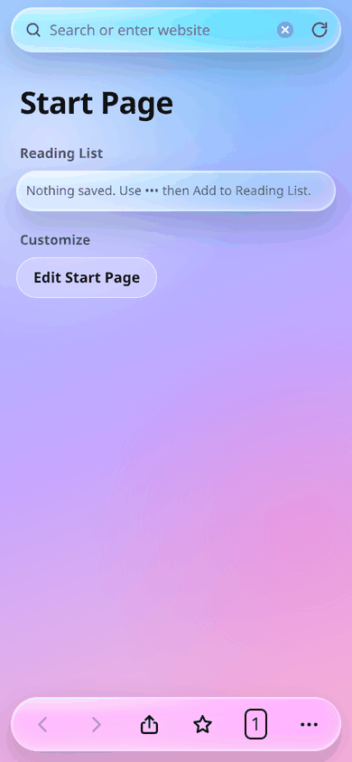
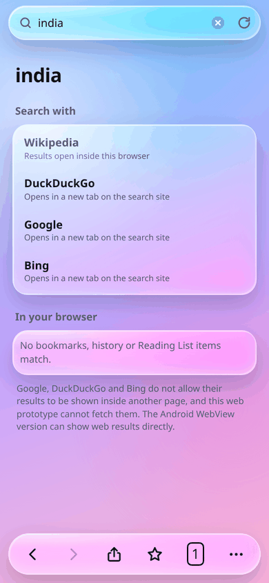
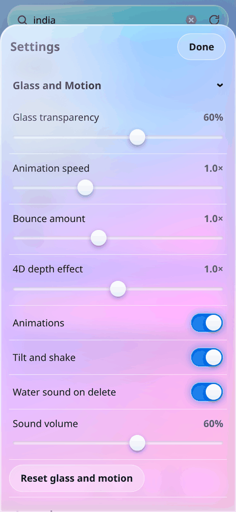
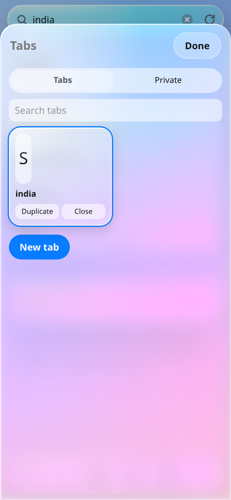
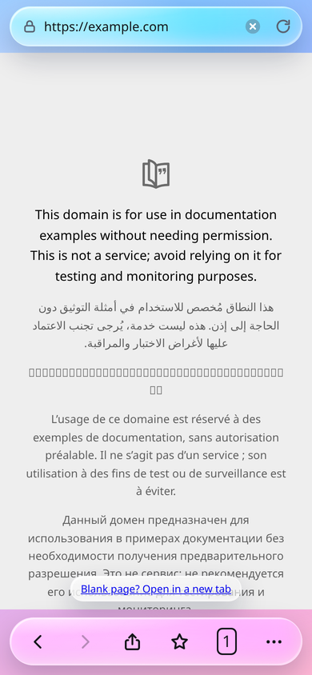
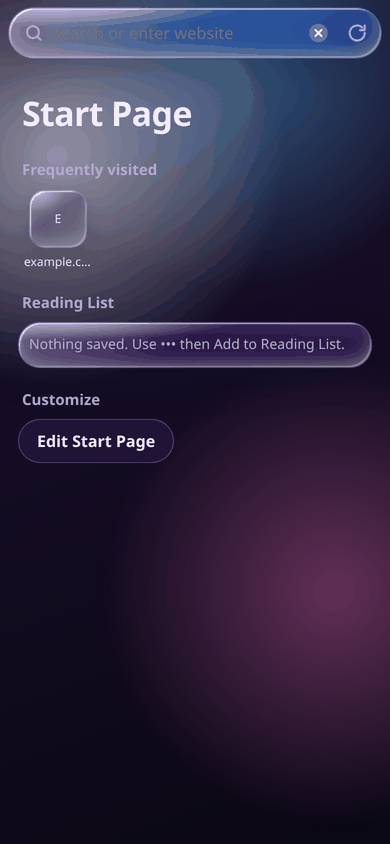
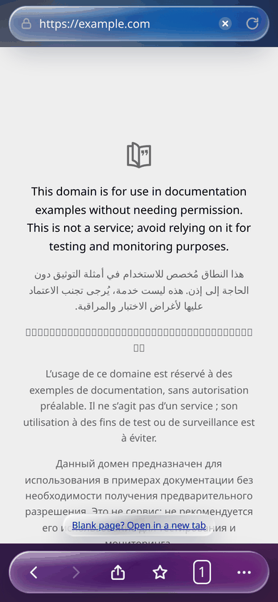

# Glass Browser — iOS

A native iOS shell for **Glass Browser**, the glassmorphism browser UI written as a single self-contained HTML file. The whole interface — start page, tabs, private tabs, bookmarks, history, reading list, reader view, settings and the glass/motion effects — is the original `Glass_Browser.html`, shipped untouched inside the app. A thin `WKWebView` layer makes it a real iOS app: it launches full screen, remembers everything between launches, opens links, and behaves like a browser.

Built and verified against the same page used by the Android build, so both platforms render an identical UI.

## Screenshots

<table>
<tr>
<td align="center"><br><sub>Start page</sub></td>
<td align="center"><br><sub>Search results</sub></td>
<td align="center"><br><sub>Settings</sub></td>
</tr>
<tr>
<td align="center"><br><sub>Tab overview</sub></td>
<td align="center"><br><sub>A page open</sub></td>
<td align="center"><br><sub>Private tab</sub></td>
</tr>
<tr>
<td align="center"><br><sub>Dark theme</sub></td>
<td></td>
<td></td>
</tr>
</table>

Captured from the page itself at 390 × 844 (iPhone 14/15 point size), rendered in Chromium — the same engine family as iOS WKWebView — so this is what the app draws, not a mockup.

## Android build

`dist/GlassBrowser.apk` is the signed Android build of the same interface — one HTML file, two shells. It is Android 5.0+ and 62 KB; sideload it, or download it from the [latest release](https://github.com/technicalnihilist-lgtm/glass-browser-ios/releases/latest).

## Requirements

- Xcode 15 or newer (the project file is `objectVersion 56`)
- iOS 15.0+ deployment target
- No CocoaPods, no Swift Package Manager, no third-party dependencies

## Getting started

```bash
git clone <this-repo>
open GlassBrowser.xcodeproj
```

Select the **GlassBrowser** scheme, pick a simulator or a connected device, and press Run. To install on a physical device, choose your team under *Signing & Capabilities* — the bundle identifier is `com.glass.browser`, change it if it clashes with something in your account.

## How it works

`BrowserViewController` hosts a `WKWebView` and loads the bundled page once:

```swift
webView.loadHTMLString(html, baseURL: URL(string: "https://appassets.local/")!)
```

That synthetic **https** base URL is the one non-obvious decision in the project, and it is deliberate.

WebKit gives a `file://` document an opaque origin. `localStorage` throws a `SecurityError` there, so the page's own `save()` calls would fail silently and every tab, bookmark, history entry and setting would vanish when the app closes. Loading the same HTML with an https base URL gives it a normal, secure, persistent origin: `localStorage` works, the clipboard API works, and storage survives relaunches through the default `WKWebsiteDataStore`.

Nothing is ever fetched from `appassets.local` — the page has no subresources, it is one file with inline CSS and JS. Sites you visit inside the page's iframe are unaffected.

Native behaviour layered on top:

- **Floating ← button** appears only when a real website is on top (Google, Bing and DuckDuckGo refuse to render inside a frame, so the page hands them off to a full-screen load). One tap returns to the glass UI.
- **Swipe-back gesture** enabled through `allowsBackForwardNavigationGestures`.
- **`target="_blank"` links** load in the same web view instead of being dropped.
- **`tel:`, `mailto:`, `sms:`, `maps:`** and other non-web schemes open in the matching app.
- **Safe areas** are left to the page: the web view is pinned to the view's edges and the HTML pads itself with `env(safe-area-inset-*)`, so the notch and home indicator are handled by the design rather than by UIKit.
- **Status bar style** follows the system light/dark appearance.

## Project layout

```
GlassBrowser.xcodeproj/          Xcode project (one app target, no dependencies)
GlassBrowser/
  AppDelegate.swift              Window + root view controller
  BrowserViewController.swift    WKWebView host, back button, navigation policy
  Glass_Browser.html             The entire UI, unchanged
  Info.plist                     Bundle metadata, ATS allows web content over http
  Assets.xcassets/               App icon
screenshots/                     Screenshots used above
dist/GlassBrowser.apk            Signed Android build of the same UI
```

## One fix carried over from the web prototype

The original page defined two action methods named `rl` — the menu's *Add to Reading List* and the reader's *Spacing*. In JavaScript the later definition wins, so **Add to Reading List silently did nothing**. It is renamed to `rlist` here and the menu entry points at it. Nothing visual changed; the Reading List now actually saves pages. This is the only edit to the HTML, and the same fix is in the Android build.

## Known limitations

These are properties of the page, not of the wrapper:

- **Search engines do not render inside the frame.** Google, Bing and DuckDuckGo send `X-Frame-Options`, so no WebView can paint their results inside an iframe. The app shows the same "can't be shown here" card and opens the site full screen, with the ← button to come back.
- **Reader View cannot extract text** from a cross-origin page, so it reports that the page can't be read.
- **The results screen still says** the Android WebView version "can show web results directly". That line is inaccurate on both platforms and is left as written in the original design.

## Related

- Android build: the same page wrapped in a `WebView` and served from a virtual origin, packaged as a signed APK.

## Licence

No licence is included yet — add one before publishing if you intend others to reuse this.
