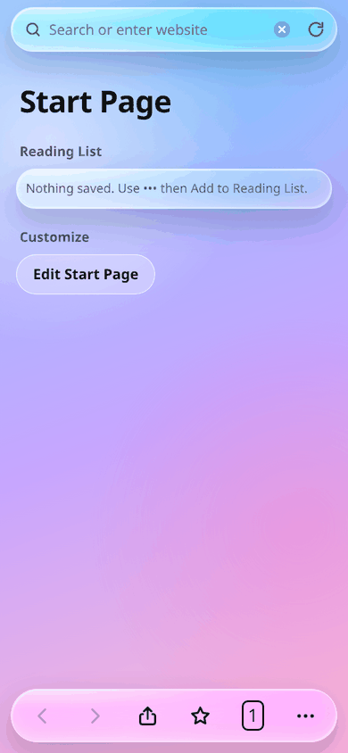
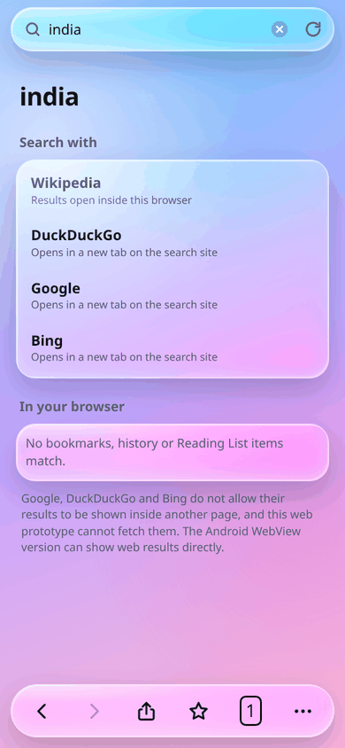
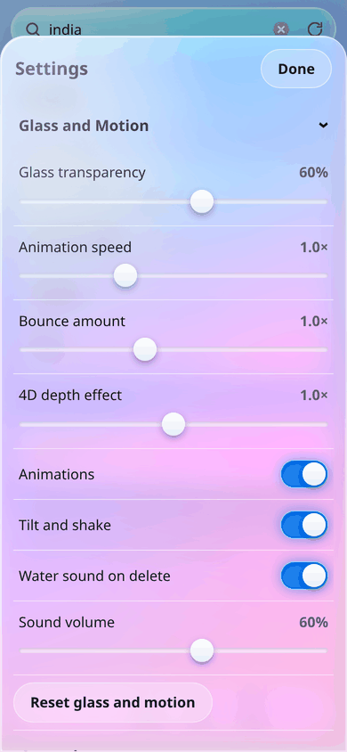
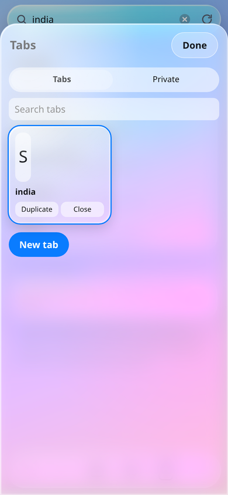
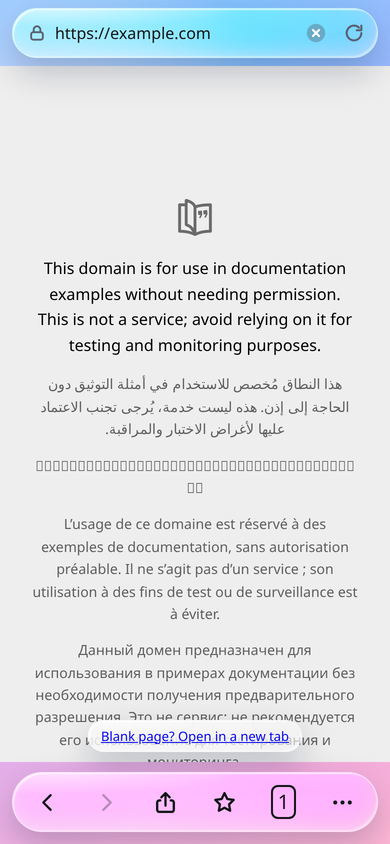
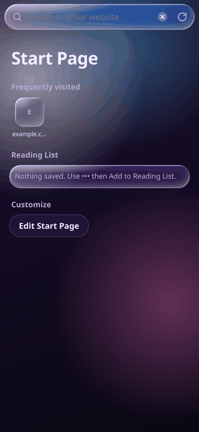
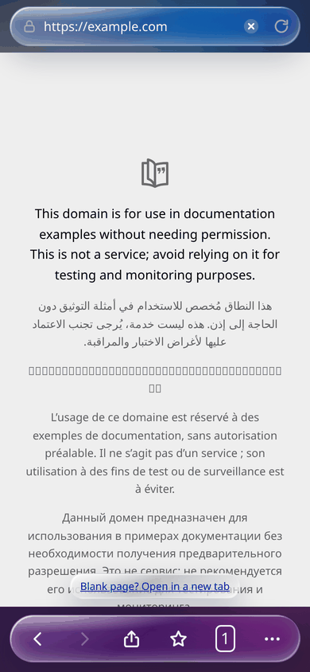
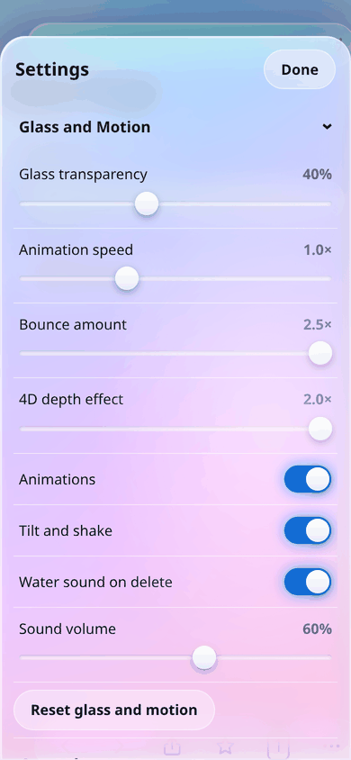
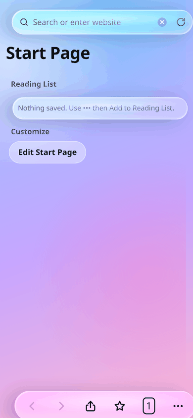

<div align="center">

<a href="https://github.com/technicalnihilist-lgtm/glass-browser-ios/stargazers"></a>&nbsp;<a href="https://github.com/technicalnihilist-lgtm/glass-browser-ios/network/members"></a>

<h3>iOS app shell for Glass Browser — a native WKWebView wrapper around the Glass Browser HTML UI…</h3>

   

<a href="https://github.com/technicalnihilist-lgtm/glass-browser-ios/releases/latest"></a>

<b>Support the work</b>

  

<sub>Donations aren't live yet — Paytm, UPI, PayPal and Buy&nbsp;Me&nbsp;a&nbsp;Coffee all show <b>coming soon</b>. Until then, a ⭐ star is the best support.</sub>

<a href="https://github.com/technicalnihilist-lgtm/glass-browser-ios/releases/latest"></a>  <a href="https://github.com/technicalnihilist-lgtm/glass-browser-ios/releases"></a>

<h4>Get it from</h4>

<a href="https://github.com/technicalnihilist-lgtm/glass-browser-ios/releases"></a> <a href="https://github.com/technicalnihilist-lgtm/glass-browser-ios/archive/refs/heads/main.zip"></a>

</div>

---

---

## Screenshots

<table>
<tr>
<td align="center"><br><sub>Start page</sub></td>
<td align="center"><br><sub>Search results</sub></td>
<td align="center"><br><sub>Settings</sub></td>
</tr>
<tr>
<td align="center"><br><sub>Tab overview</sub></td>
<td align="center"><br><sub>A page open</sub></td>
<td align="center"><br><sub>Private tab</sub></td>
</tr>
<tr>
<td align="center"><br><sub>Dark theme</sub></td>
<td align="center"><br><sub>Glass &amp; Motion: bounce 2.5x, 4D depth 2.0x</sub></td>
<td align="center"><br><sub>4D depth tilting the UI</sub></td>
</tr>
</table>

Captured from the page itself at 390 × 844 (iPhone 14/15 point size), rendered in Chromium — the same engine family as iOS WKWebView — so this is what the app draws, not a mockup.

## Android build

`dist/GlassBrowser.apk` is the signed Android build of the same interface — one HTML file, two shells. It is Android 5.0+ and 62 KB; sideload it, or download it from the [latest release](https://github.com/technicalnihilist-lgtm/glass-browser-ios/releases/latest).

## Requirements

- Xcode 15 or newer (the project file is `objectVersion 56`)
- iOS 15.0+ deployment target
- No CocoaPods, no Swift Package Manager, no third-party dependencies

## How it works

`BrowserViewController` hosts a `WKWebView` and loads the bundled page once:

```swift
webView.loadHTMLString(html, baseURL: URL(string: "https://appassets.local/")!)
```

That synthetic **https** base URL is the one non-obvious decision in the project, and it is deliberate.

WebKit gives a `file://` document an opaque origin. `localStorage` throws a `SecurityError` there, so the page's own `save()` calls would fail silently and every tab, bookmark, history entry and setting would vanish when the app closes. Loading the same HTML with an https base URL gives it a normal, secure, persistent origin: `localStorage` works, the clipboard API works, and storage survives relaunches through the default `WKWebsiteDataStore`.

Nothing is ever fetched from `appassets.local` — the page has no subresources, it is one file with inline CSS and JS. Sites you visit inside the page's iframe are unaffected.

Native behaviour layered on top:

- **Floating ← button** appears only when a real website is on top (Google, Bing and DuckDuckGo refuse to render inside a frame, so the page hands them off to a full-screen load). One tap returns to the glass UI.
- **Swipe-back gesture** enabled through `allowsBackForwardNavigationGestures`.
- **`target="_blank"` links** load in the same web view instead of being dropped.
- **`tel:`, `mailto:`, `sms:`, `maps:`** and other non-web schemes open in the matching app.
- **Safe areas** are left to the page: the web view is pinned to the view's edges and the HTML pads itself with `env(safe-area-inset-*)`, so the notch and home indicator are handled by the design rather than by UIKit.
- **Status bar style** follows the system light/dark appearance.

## Project layout

```
GlassBrowser.xcodeproj/          Xcode project (one app target, no dependencies)
GlassBrowser/
  AppDelegate.swift              Window + root view controller
  BrowserViewController.swift    WKWebView host, back button, navigation policy
  Glass_Browser.html             The entire UI, unchanged
  Info.plist                     Bundle metadata, ATS allows web content over http
  Assets.xcassets/               App icon
screenshots/                     Screenshots used above
dist/GlassBrowser.apk            Signed Android build of the same UI
```

## One fix carried over from the web prototype

The original page defined two action methods named `rl` — the menu's *Add to Reading List* and the reader's *Spacing*. In JavaScript the later definition wins, so **Add to Reading List silently did nothing**. It is renamed to `rlist` here and the menu entry points at it. Nothing visual changed; the Reading List now actually saves pages. This is the only edit to the HTML, and the same fix is in the Android build.

## Known limitations

These are properties of the page, not of the wrapper:

- **Search engines do not render inside the frame.** Google, Bing and DuckDuckGo send `X-Frame-Options`, so no WebView can paint their results inside an iframe. The app shows the same "can't be shown here" card and opens the site full screen, with the ← button to come back.
- **Reader View cannot extract text** from a cross-origin page, so it reports that the page can't be read.
- **The results screen still says** the Android WebView version "can show web results directly". That line is inaccurate on both platforms and is left as written in the original design.

## Related

- Android build: the same page wrapped in a `WebView` and served from a virtual origin, packaged as a signed APK.

## Store submission

Notes for the Orion Store listing — payload, icon and screenshot links — are in [store/orion-submission.md](store/orion-submission.md).

## Licence

MIT — see [LICENSE](LICENSE). In short: use it, change it, ship it, sell it; just keep the copyright notice and don't expect a warranty.

The bundled `Glass_Browser.html` and the Android build in `dist/` are covered by the same licence.

---

---

## 🌍 Languages

<sub>Donations are <b>coming soon</b> in every language below — nothing to pay today, nothing to click.</sub>

<div align="center">

<sub><b>हिन्दी · বাংলা · मराठी · తెలుగు · தமிழ் · ગુજરાતી · ಕನ್ನಡ · മലയാളം · ਪੰਜਾਬੀ · ଓଡ଼ିଆ · অসমীয়া · اردو</b></sub>

</div>

<details>
<summary><b>🌍 Open the same message in 53 languages</b></summary>

**🇮🇳 Indian languages**

- **हिन्दी** (Hindi) — ☕ जल्द ही आ रहा है। · ⭐ अगर आपको यह ऐप और हमारा काम पसंद है, तो कृपया रिपॉजिटरी को स्टार दें और हमें फॉलो करें।
- **বাংলা** (Bengali) — ☕ খুব শিগগিরই আসছে। · ⭐ যদি আপনার এই অ্যাপ এবং আমাদের কাজ ভালো লাগে, তবে অনুগ্রহ করে রিপোজিটরিটিকে একটি স্টার দিন এবং আমাদের ফলো করুন।
- **मराठी** (Marathi) — ☕ लवकरच येत आहे. · ⭐ जर तुम्हाला हे ॲप आणि आमचं काम आवडलं असेल, तर कृपया रिपॉझिटरीला स्टार द्या आणि आम्हाला फॉलो करा.
- **తెలుగు** (Telugu) — ☕ త్వరలో రాబోతోంది. · ⭐ మీకు ఈ యాప్, మా పని నచ్చితే, దయచేసి రిపోజిటరీకి ఒక స్టార్ ఇచ్చి మమ్మల్ని ఫాలో అవ్వండి.
- **தமிழ்** (Tamil) — ☕ விரைவில் வருகிறது. · ⭐ உங்களுக்கு இந்த ஆப்பும் எங்க வேலையும் பிடிச்சிருந்தா, தயவுசெஞ்சு இந்த ரெபாசிட்டரிக்கு ஒரு ஸ்டார்…
- **ગુજરાતી** (Gujarati) — ☕ ટૂંક સમયમાં આવી રહ્યું છે. · ⭐ જો તમને આ એપ અને અમારું કામ ગમતું હોય, તો પ્લીઝ રિપોઝિટરીને સ્ટાર આપો અને અમને ફોલો કરો.
- **ಕನ್ನಡ** (Kannada) — ☕ ಶೀಘ್ರದಲ್ಲೇ ಬರುತ್ತಿದೆ. · ⭐ ನಿಮಗೆ ಈ ಆ್ಯಪ್ ಮತ್ತು ನಮ್ಮ ಕೆಲಸ ಇಷ್ಟವಾದರೆ, ದಯವಿಟ್ಟು ರೆಪೊಸಿಟರಿಗೆ ಸ್ಟಾರ್ ಕೊಡಿ ಮತ್ತು ನಮ್ಮನ್ನು ಫಾಲೋ ಮಾಡಿ.
- **മലയാളം** (Malayalam) — ☕ ഉടൻ വരുന്നു. · ⭐ നിങ്ങൾക്ക് ഈ ആപ്പും ഞങ്ങളുടെ പ്രവർത്തനവും ഇഷ്ടപ്പെട്ടെങ്കിൽ, ദയവായി റെപ്പോസിറ്ററിക്ക് ഒരു സ്റ്റാർ…
- **ਪੰਜਾਬੀ** (Punjabi) — ☕ ਜਲਦੀ ਆ ਰਿਹਾ ਹੈ। · ⭐ ਜੇ ਤੁਹਾਨੂੰ ਇਹ ਐਪ ਅਤੇ ਸਾਡਾ ਕੰਮ ਪਸੰਦ ਹੈ, ਤਾਂ ਕਿਰਪਾ ਕਰਕੇ ਰਿਪੋਜ਼ਟਰੀ ਨੂੰ ਸਟਾਰ ਦਿਓ ਅਤੇ ਸਾਨੂੰ ਫਾਲੋ ਕਰੋ।
- **ଓଡ଼ିଆ** (Odia) — ☕ ଖୁବ୍ ଶୀଘ୍ର ଆସୁଛି। · ⭐ ଯଦି ଆପଣଙ୍କୁ ଏହି ଆପ୍ ଏବଂ ଆମର କାମ ଭଲ ଲାଗୁଛି, ତେବେ ଦୟାକରି ରିପୋଜିଟୋରୀକୁ ଗୋଟିଏ ଷ୍ଟାର୍ ଦିଅନ୍ତୁ ଏବଂ ଆମକୁ ଫଲୋ କରନ୍ତୁ।
- **অসমীয়া** (Assamese) — ☕ অতি সোনকালেই আহি আছে। · ⭐ যদি আপুনি এই এপটো আৰু আমাৰ কাম ভাল পায়, তেন্তে অনুগ্ৰহ কৰি ৰিপজিটৰীটোক এটা ষ্টাৰ দিয়ক আৰু আমাক ফ'ল' কৰক।
- **اردو** (Urdu) — ☕ جلد آرہا ہے۔ · ⭐ اگر آپ کو یہ ایپ اور ہمارا کام پسند آئے تو براہ کرم ریپازٹری کو سٹار دیں اور ہمیں فالو کریں۔
- **संस्कृतम्** (Sanskrit) — ☕ शीघ्रमेव आगच्छति।
- **मैथिली** (Maithili) — ☕ जल्दिये आबि रहल अछि।
- **कोंकणी** (Konkani) — ☕ रोखडेंच येता.
- **کٲشُر** (Kashmiri) — ☕ جَلدی یِوان چھُ۔
- **سنڌي** (Sindhi) — ☕ जल्द अची रह्यो आहे।
- **डोगरी** (Dogri) — ☕ जल्दी आ करदा ऐ।
- **ꯃꯤꯇꯩ ꯂꯣꯟ** (Manipuri) — ☕ ꯑꯊꯨꯕꯥ ꯃꯇꯝꯗꯥ ꯂꯥꯛꯀꯅꯤ꯫
- **बर’** (Bodo) — ☕ थाबैनो फैगोन।
- **ᱥᱟᱱᱛᱟᱲᱤ** (Santali) — ☕ ᱞᱚᱜᱚᱱ ᱦᱤᱡᱩᱜ ᱠᱟᱱᱟ᱾
- **नेपाली** (Nepali) — ☕ छिट्टै आउँदैछ। · ⭐ यदि तपाईंलाई यो एप र हाम्रो काम मन पर्‍यो भने, कृपया रिपोजिटरीलाई स्टार दिनुहोस् र हामीलाई फलो गर्नुहोस्।

**🌍 World languages**

- **العربية** (Arabic) — ☕ قريبًا. · ⭐ إذا أعجبك هذا التطبيق وعملنا، فيرجى منح المستودع نجمة ومتابعتنا.
- **简体中文** (Chinese (Simplified)) — ☕ 即将推出。
- **繁體中文** (Chinese (Traditional)) — ☕ 即將推出。
- **Čeština** (Czech) — ☕ Již brzy.
- **Dansk** (Danish) — ☕ Kommer snart.
- **Nederlands** (Dutch) — ☕ Binnenkort beschikbaar. · ⭐ Vind je deze app en ons werk leuk?
- **Filipino** (Filipino) — ☕ Malapit na.
- **Suomi** (Finnish) — ☕ Tulossa pian.
- **Français** (French) — ☕ Bientôt disponible. · ⭐ Si cette application et notre travail vous plaisent, mettez une étoile au dépôt et suivez-nous.
- **Deutsch** (German) — ☕ Bald verfügbar. · ⭐ Wenn dir diese App und unsere Arbeit gefallen, gib dem Repository einen Stern und folge uns.
- **Ελληνικά** (Greek) — ☕ Έρχεται σύντομα.
- **עברית** (Hebrew) — ☕ בקרוב.
- **Magyar** (Hungarian) — ☕ Hamarosan.
- **Bahasa Indonesia** (Indonesian) — ☕ Segera hadir. · ⭐ Jika kamu suka aplikasi ini dan karya kami, beri bintang pada repositori ini dan ikuti kami.
- **Italiano** (Italian) — ☕ In arrivo.
- **日本語** (Japanese) — ☕ 近日公開。 · ⭐ このアプリと私たちの仕事が気に入ったら、リポジトリにスターを付けてフォローしてください。
- **한국어** (Korean) — ☕ 곧 공개됩니다. · ⭐ 이 앱과 저희 작업이 마음에 드신다면 저장소에 스타를 눌러 주시고 팔로우해 주세요.
- **Bahasa Melayu** (Malay) — ☕ Akan datang.
- **Norsk** (Norwegian) — ☕ Kommer snart.
- **فارسی** (Persian) — ☕ به‌زودی.
- **Polski** (Polish) — ☕ Wkrótce. · ⭐ Jeśli podoba Ci się ta aplikacja i nasza praca, daj repozytorium gwiazdkę i obserwuj nas.
- **Português** (Portuguese) — ☕ Em breve.
- **Română** (Romanian) — ☕ În curând.
- **Русский** (Russian) — ☕ Скоро. · ⭐ Если вам нравится это приложение и наша работа, поставьте звёздочку репозиторию и подпишитесь на нас.
- **Español** (Spanish) — ☕ Muy pronto. · ⭐ Si te gusta esta app y nuestro trabajo, dale una estrella al repositorio y síguenos.
- **Kiswahili** (Swahili) — ☕ Inakuja hivi karibuni.
- **Svenska** (Swedish) — ☕ Kommer snart.
- **ไทย** (Thai) — ☕ เร็ว ๆ นี้
- **Türkçe** (Turkish) — ☕ Çok yakında.
- **Українська** (Ukrainian) — ☕ Незабаром.
- **Tiếng Việt** (Vietnamese) — ☕ Sắp ra mắt. · ⭐ Nếu bạn thích ứng dụng này và công việc của chúng tôi, hãy tặng kho lưu trữ một ngôi sao và theo…

</details>

